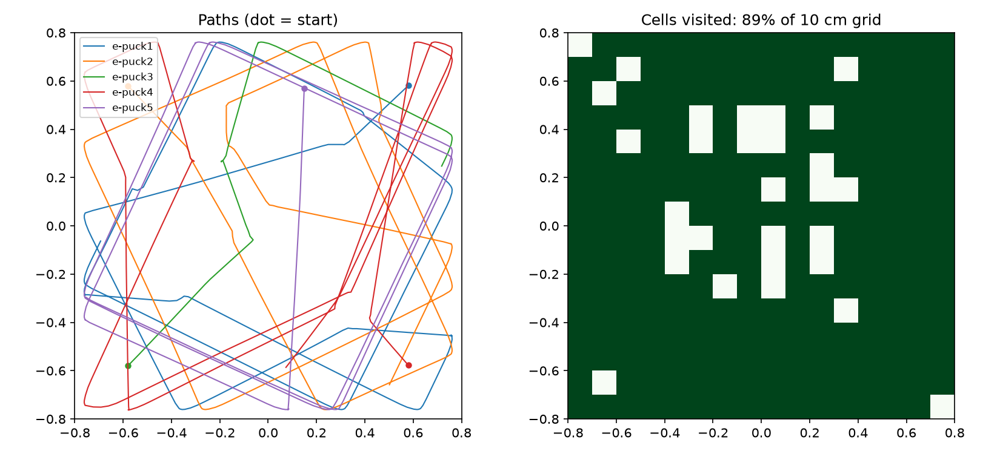
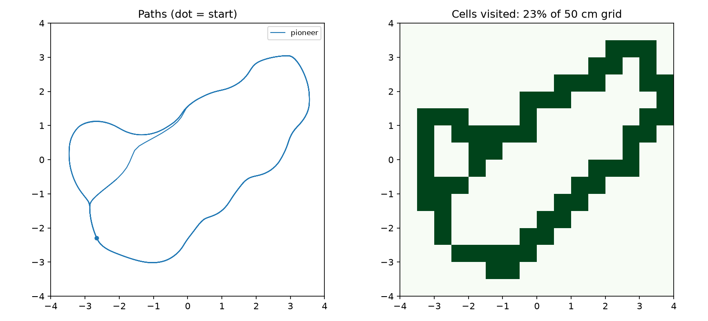
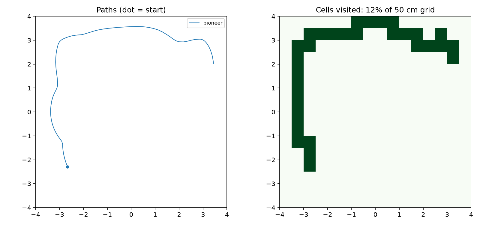

# Step-by-step guide: run the experiments and learn how robots move

This guide takes you from a fresh computer to running both robot experiments, changing their parameters, and measuring what changed. It works on **macOS, Windows and Linux**. You don't need a real robot. Webots simulates the physics (wheels, friction, mass, collisions) and the sensors (infrared, lidar), so what you learn here carries over to physical robots.

**Contents**

1. [What you need](#1-what-you-need)
2. [Install Webots](#2-install-webots) ([macOS](#macos) · [Windows](#windows) · [Linux](#linux))
3. [Install Python](#3-install-python)
4. [Get this project](#4-get-this-project)
5. [Run the experiments in the Webots window](#5-run-the-experiments-in-the-webots-window)
6. [Run experiments from the command line and measure them](#6-run-experiments-from-the-command-line-and-measure-them)
7. [How the algorithms work](#7-how-the-algorithms-work)
8. [Parameters you can change, and what we measured](#8-parameters-you-can-change-and-what-we-measured)
9. [Changing the physical world](#9-changing-the-physical-world)
10. [Exercises](#10-exercises)
11. [Troubleshooting](#11-troubleshooting)

---

## 1. What you need

| | Minimum |
|---|---|
| Computer | Any laptop from the last ~6 years. A dedicated GPU helps, but Apple Silicon and Intel graphics work fine for these small worlds |
| Disk space | About 1.5 GB for Webots, plus a few MB for this project |
| Internet | Needed the **first** time you open each world, because Webots downloads robot models and textures. They're cached after that |
| Software | Webots R2025a, Python 3, and optionally Git |

Everything is free and open source.

---

## 2. Install Webots

Webots is made by Cyberbotics (<https://cyberbotics.com>). All installers are on the official release page:
<https://github.com/cyberbotics/webots/releases/tag/R2025a>

### macOS

1. Download **`webots-R2025a.dmg`** (about 107 MB). It runs natively on both Apple Silicon (M1–M4) and Intel Macs.
2. Double-click the `.dmg`, then drag **Webots** into **Applications**.
3. Open Webots from Applications. If macOS says it "can't be opened because Apple cannot check it", go to **System Settings → Privacy & Security**, scroll down and click **Open Anyway**. You only need to do this once.
   - Or, in Terminal, clear the download-quarantine flag:
     ```bash
     xattr -dr com.apple.quarantine /Applications/Webots.app
     ```
4. You may see a warning that your GPU is "below the minimal requirements". You can ignore it for these worlds; Webots just turns off shadows and anti-aliasing.

> Homebrew's `webots` cask is currently disabled, so use the `.dmg`.

### Windows

1. Download **`webots-R2025a_setup.exe`** (about 263 MB).
2. Run it. Choose **"Install for me"** (no admin rights needed) or **"Install for all users"**. Keep the default folder.
3. Open **Webots** from the Start menu.
4. If Windows SmartScreen appears, click **More info → Run anyway**.

### Linux

Ubuntu 22.04 or 24.04 is recommended. Pick **one** of these options.

**Option A: `.deb` package (simplest on Ubuntu/Debian)**
```bash
wget https://github.com/cyberbotics/webots/releases/download/R2025a/webots_2025a_amd64.deb
```
```bash
sudo apt install ./webots_2025a_amd64.deb
```

**Option B: Snap (any distro with snapd)**
```bash
sudo snap install webots
```

**Option C: tarball (no root needed)**
```bash
wget https://github.com/cyberbotics/webots/releases/download/R2025a/webots-R2025a-x86-64.tar.bz2
```
```bash
tar xjf webots-R2025a-x86-64.tar.bz2 && export WEBOTS_HOME=$PWD/webots
```

Then start it with:
```bash
webots
```
(For Option C, use `$WEBOTS_HOME/webots`.)

---

## 3. Install Python

The robot "brains" (controllers) in this project are Python files. Webots runs them with your system Python.

| OS | What to do | Check it works |
|---|---|---|
| macOS | Python 3 comes with the Xcode command-line tools, or install it from <https://www.python.org/downloads/> or with `brew install python` | `python3 --version` |
| Windows | Install from <https://www.python.org/downloads/>. **Tick "Add python.exe to PATH"** on the first installer screen | `python --version` |
| Linux | Usually already installed. If not: `sudo apt install python3 python3-venv` | `python3 --version` |

We tested with Python 3.11 and 3.14 on macOS.

**If you have several Pythons installed**, tell Webots which one to use: **Webots → Preferences → General → Python command**. Put the full path there, e.g. `/usr/local/bin/python3.11` or `C:\Python311\python.exe`.

**Optional, for the plots:** install `matplotlib` and `numpy` in a virtual environment inside the project folder (step 4 first):

macOS / Linux:
```bash
python3 -m venv .venv && .venv/bin/pip install matplotlib numpy
```
Windows (PowerShell):
```powershell
python -m venv .venv; .venv\Scripts\pip install matplotlib numpy
```

---

## 4. Get this project

**With Git:**
```bash
git clone https://github.com/reshamrajs/webots-robotics-sim.git
```
```bash
cd webots-robotics-sim
```

**Without Git:** on the GitHub page click **Code → Download ZIP**, unzip it, and open a terminal in that folder.

The folders you'll use:

```
worlds/        the two simulated environments (.wbt files)
controllers/   the Python code that drives each robot
tools/         run_experiment.py: run a world headless with chosen parameters
analysis/      metrics.py and plot_trajectories.py, plus saved results
```

---

## 5. Run the experiments in the Webots window

### Experiment 1: e-puck swarm

1. Open Webots.
2. **File → Open World…** and choose `worlds/swarm_arena.wbt`.
3. The first time, wait while Webots downloads the e-puck model (a progress bar shows at the bottom).
4. The simulation starts automatically. The toolbar buttons control it: **Pause**, **Step** (one time step), **Real-time** (▶), **Fast** (▶▶). **Reset Simulation** puts everything back at the start.
5. Watch the five small robots. Each one drives forward and turns away from walls, boxes, barrels and other robots.
6. After **120 simulated seconds** the simulation pauses on its own. A hidden "logger" robot has saved every robot's position to `analysis/trajectories.csv`.
7. Plot it:
   - macOS / Linux: `.venv/bin/python analysis/plot_trajectories.py`
   - Windows: `.venv\Scripts\python analysis\plot_trajectories.py`

   This writes `analysis/trajectories.png`: robot paths on the left, the parts of the floor that were visited on the right.

**Things to try in the window**
- Drag a robot with the mouse (hold **Shift** and drag) and drop it in a corner. Watch it escape.
- Select a robot in the scene tree on the left and open its **controller** console (bottom panel) to see messages.
- Double-click a robot to open its **robot window**, which shows the live readings of all 8 infrared sensors.

### Experiment 2: Pioneer 3-DX with lidar

1. **File → Open World…** and choose `worlds/pioneer_lidar.wbt`.
2. The Pioneer (a 9 kg research robot) drives through an 8 × 8 m room using a SICK LMS 291 laser scanner.
3. The console prints a line about every 2 seconds:
   ```
   t=  19.2s  nearest=0.80 m  front=1.88 m  heading_cmd=-11.6 deg  v=0.60 m/s
   ```
   `nearest` is the closest object in any direction, `front` is the closest object ahead, `heading_cmd` is where the robot is steering, and `v` is its forward speed.
4. To see the laser beams: **View → Optional Rendering → Show Lidar Ray Paths**.
5. After 180 s the logger saves `analysis/pioneer_trajectory.csv`. Plot it with:
   ```bash
   .venv/bin/python analysis/plot_trajectories.py analysis/pioneer_trajectory.csv
   ```

### Change a parameter from the Webots window (no coding)

1. In the scene tree on the left, expand a robot (e.g. `DEF EPUCK1 E-puck`).
2. Find the field **controllerArgs**. Double-click it and add an entry such as `--cruise=0.9`.
3. Do the same for the other robots if you want them all to change.
4. Press **Reset Simulation**. The robot now runs with the new value.
5. **File → Save World** if you want to keep the change.

All parameter names are listed in [section 8](#8-parameters-you-can-change-and-what-we-measured).

---

## 6. Run experiments from the command line and measure them

`tools/run_experiment.py` runs a world **without a window, as fast as your computer allows**, applies your parameters to every robot, and prints measurements. It finds Webots automatically in its standard install location. If you installed it elsewhere, set `WEBOTS_HOME` to the install folder first.

Use `python3` on macOS/Linux and `python` on Windows:

```bash
python3 tools/run_experiment.py swarm --seconds 120
```
```bash
python3 tools/run_experiment.py swarm --seconds 120 --set cruise=0.9
```
```bash
python3 tools/run_experiment.py pioneer --seconds 180 --set bubble=0.15
```

You can pass several parameters at once: `--set cruise=0.8 gain=6`.

Example output:
```
Running swarm for 120 s with ['cruise=0.9'] ...
Trajectory: analysis/runs/swarm_cruise-0.9.csv
robot       path m  mean m/s  stuck %
e-puck1      10.22     0.085      2.4
e-puck2      10.60     0.089      2.4
e-puck3       2.65     0.022     75.7
e-puck4      10.98     0.092      5.3
e-puck5      11.56     0.097      3.5
coverage: 89% of 16x16 grid (10 cm cells)
```

| Metric | Meaning |
|---|---|
| **path m** | Total distance the robot drove, in metres |
| **mean m/s** | Average speed over the whole run |
| **stuck %** | Share of the time the robot moved slower than 1 cm/s, which usually means it's wedged against something |
| **coverage** | Share of the floor, divided into a grid, that any robot passed over. It measures how well the robots *explore* |

Every run saves its CSV in `analysis/runs/`. To plot one:
```bash
.venv/bin/python analysis/plot_trajectories.py analysis/runs/swarm_cruise-0.9.csv
```

> **Runs aren't bit-for-bit identical.** The robots' programs run as separate processes, so tiny timing differences can change which way a robot turns at a close call. In our tests the default swarm run gave 75–86% coverage. To compare two settings fairly, run each one 3–5 times and compare the averages.

---

## 7. How the algorithms work

### 7.1 Braitenberg vehicle (e-puck swarm)

**Idea:** wire each sensor straight to the motors with a fixed weight. There's no map, no planning and no memory, and yet the robot avoids obstacles. Valentino Braitenberg described this in *Vehicles* (1984). It's the simplest working example of **reactive control**.

**Sensors.** The e-puck has 8 infrared proximity sensors (`ps0`…`ps7`) around its body. Each one returns roughly 60 when nothing is near and up to about 4000 when something is touching it. We scale each reading to the range 0–1:

$$x_i = \min(\text{ps}_i, 4096) / 4096$$

**Control law.** For each wheel:

$$v_L = \text{cruise} + \text{gain}\sum_{i=0}^{7} w^L_i\,x_i \qquad v_R = \text{cruise} + \text{gain}\sum_{i=0}^{7} w^R_i\,x_i$$

Both values are clipped to [−1, 1] and multiplied by the top wheel speed (6.28 rad/s) and by `speed`.

The weights are mirror images:

| Sensor | ps0 | ps1 | ps2 | ps3 | ps4 | ps5 | ps6 | ps7 |
|---|---|---|---|---|---|---|---|---|
| Position | front-right | right-front | right | back-right | back-left | left | left-front | front-left |
| $w^L$ (left wheel) | −1.3 | −1.0 | −0.5 | 0 | 0 | 0.5 | 1.0 | 1.3 |
| $w^R$ (right wheel) | 1.3 | 1.0 | 0.5 | 0 | 0 | −0.5 | −1.0 | −1.3 |

So an obstacle on the **right** slows the left wheel and speeds up the right wheel, and the robot **turns left**, away from it. An obstacle straight ahead triggers both front sensors. If they're unequal the robot turns; if they're nearly equal it slows down until one side wins.

**Pseudo-code** (`controllers/epuck_braitenberg/epuck_braitenberg.py`):
```
every 32 ms:
    read 8 sensors, scale to 0..1
    vL = cruise + gain * sum(wL[i] * x[i])
    vR = cruise + gain * sum(wR[i] * x[i])
    clip both to [-1, 1], multiply by max wheel speed
    send to motors
```

Each robot also gets a small fixed speed difference (85–97%), so the swarm doesn't move in lock-step.

### 7.2 Follow-the-gap (Pioneer with lidar)

**Idea:** look at a 180° laser scan, find the widest opening, and drive toward its middle. Slow down when something is close ahead. This method is widely used in autonomous racing (e.g. F1TENTH) because it's fast and needs no map.

**Every 32 ms:**

1. **Read the scan.** The lidar returns 180 distances $r_0 \ldots r_{179}$, from +90° (left) to −90° (right). Any value beyond `lookahead` is clipped to `lookahead`.
2. **Mark free beams.** A beam is *free* if $r_i >$ `free` (1 m by default).
3. **Cut a safety bubble.** Find the closest return $r_k$. Mark every beam within an angle $\arctan(\text{bubble}/r_k)$ of it as *blocked*. This keeps the robot from cutting corners next to the nearest obstacle.
4. **Find the widest gap,** the longest run of consecutive free beams. If there is none, turn left on the spot.
5. **Steer to its middle.** The target heading $\theta$ is the angle of the middle beam in the gap.
6. **Choose speeds.** With $d_\text{front}$ the closest return in the middle third of the scan:

   $$v = \begin{cases} 0 & d_\text{front} < \text{stop} \\ \min(\text{max\_v},\ \text{slow}\cdot d_\text{front}) & \text{otherwise}\end{cases} \qquad \omega = \text{clip}(\text{k\_turn}\cdot\theta,\ \pm\text{max\_w})$$

7. **Convert to wheel speeds** (differential-drive kinematics). The wheel radius is $R = 0.0975$ m and the wheel spacing is $L = 0.33$ m:

   $$\omega_L = \frac{v - \omega L/2}{R} \qquad \omega_R = \frac{v + \omega L/2}{R}$$

   If either wheel would exceed 12.3 rad/s, both are scaled down together, so the robot keeps the same curve but drives it more slowly.

Step 7 is the same equation every two-wheeled robot uses, from a Roomba to a warehouse AGV. Change $L$ or $R$ and the same command produces a different motion.

### 7.3 Supervisor logger

A **supervisor** is a special Webots robot that can see and change everything in the world, like the experimenter's hand. `controllers/trajectory_logger` reads the true position of each robot every 0.32 s and writes it to a CSV. A real lab would need motion capture or an overhead camera to do this.

---

## 8. Parameters you can change, and what we measured

All numbers below are real runs made with `tools/run_experiment.py` (Webots R2025a, macOS, Apple M-series). Only one parameter was changed per row. Expect some variation between runs (see section 6).

### e-puck swarm (120 s, 5 robots)

| Parameter | Default | What it does |
|---|---|---|
| `cruise` | 0.5 | Forward drive when nothing is near (0–1) |
| `gain` | 4.0 | How strongly the sensors steer the robot |
| `speed` | 1.0 | Scales the final wheel speed (0–1) |
| `noise` | 0.0 | Random wheel-speed noise, like uneven motors or slipping wheels |

| Run | Mean path per robot | Worst robot stuck | Coverage | What happened |
|---|---|---|---|---|
| default | 6.4 m | 2.7% | 75% | Smooth avoidance, no robot trapped |
| `cruise=0.9` | 9.2 m | **75.7%** | 89% | Faster robots explore more, but **e-puck3 drove into a corner too fast to turn and got wedged** for most of the run |
| `cruise=0.2` | 2.7 m | 0.3% | 55% | Very safe and very slow; half the floor never reached |
| `gain=1` | 6.4 m | 5.1% | 77% | Weak reactions: robots brush obstacles and get stuck briefly more often |
| `gain=10` | 6.5 m | 1.9% | 82% | Strong reactions: robots turn away earlier and get stuck less |
| `speed=0.5` | 3.4 m | 0.5% | 61% | Same paths, half as far |
| `noise=0.3` | 6.4 m | 2.1% | 74% | Motor noise made almost no difference, because the sensors keep correcting it |

**Lesson:** speed and safety pull against each other. A reactive robot needs time to react, so if it moves faster than its sensors can "see" (the e-puck's IR range is only ~5 cm), it can hit something it never had a chance to avoid.



### Pioneer lidar navigation (180 s)

| Parameter | Default | What it does |
|---|---|---|
| `lookahead` | 2.5 m | Beams longer than this are clipped |
| `free` | 1.0 m | A beam longer than this counts as part of a gap |
| `bubble` | 0.45 m | Safety radius cut around the closest obstacle |
| `stop` | 0.35 m | Stop driving forward (turn only) if something is closer than this ahead |
| `max_v` | 0.6 m/s | Top forward speed |
| `slow` | 0.35 | Forward speed = `slow` × front distance, capped at `max_v` |
| `k_turn` | 2.0 | Turn rate per radian of heading error (the steering gain) |
| `max_w` | 1.5 rad/s | Maximum turn rate |

| Run | Distance | Stuck | Coverage (50 cm cells) | What happened |
|---|---|---|---|---|
| default | 83.6 m | 0% | 23% | Never touched anything, but **drove the same closed loop over and over** |
| `lookahead=1.2` | 69.9 m | 0% | 23% | Sees less of the room, so it drives slower (speed depends on front distance) |
| `lookahead=5` | 83.6 m | 0% | 23% | **Identical to default.** Speed is capped once the front distance passes 1.7 m, so seeing further changed nothing |
| `bubble=0.15` | 13.4 m | **77%** | 12% | Bubble smaller than the robot's half-width (0.19 m): it **steered into a barrel and stayed there** |
| `bubble=0.9` | 79.8 m | 0% | 24% | Wider berth, slightly shorter path |
| `k_turn=0.5` | 74.3 m | 0% | **29%** | Lazy steering took wider curves and broke out of the loop a little |
| `k_turn=6` | 83.5 m | 0% | 23% | Sharp steering, same loop |
| `max_v=1.2` | 85.6 m | 0% | 21% | Barely faster: the `slow × front` rule still limits speed |
| `stop=0.8` | 10.9 m | **85%** | 11% | Too cautious: it stopped whenever anything was within 0.8 m ahead and rarely found a way out |

**Lessons:**
1. **A reactive controller has no memory.** It never knows it has been somewhere before, so in a fixed room it settles into a loop. Exploring the whole room needs a map (e.g. an occupancy grid) or a goal. That's the step from *reactive* to *deliberative* robotics.
2. **Safety margins must match the robot's real size.** The Pioneer is 0.38 m wide, so a 0.15 m bubble is a bug in the physical world.
3. **Parameters interact.** `max_v` and `lookahead` did almost nothing alone because another rule (`slow × front`) was the real limit. Always check which constraint is actually active.




---

## 9. Changing the physical world

The worlds are plain text files, so you can edit them in any text editor or in the Webots scene tree. After editing, **reload the world** (toolbar ↻) or **Reset Simulation**.

| What to change | Where | Real-world effect to look for |
|---|---|---|
| **Simulation time step** | `WorldInfo { basicTimeStep 32 }` → try 8 or 64 | 8 ms gives finer physics and faster reactions; 64 ms makes robots react late, like a slow processor |
| **Floor friction** | Add to `WorldInfo`: `contactProperties [ ContactProperties { coulombFriction [ 0.2 ] } ]` (default is 1) | Low friction makes wheels slip, so turns overshoot, like driving on a polished floor or ice |
| **Gravity** | `WorldInfo { gravity 1.62 }` (the Moon) | Less grip and more bouncing on bumps |
| **Arena size** | `RectangleArena { floorSize 1.6 1.6 }` | More space spreads the swarm out; less space means more robot-to-robot contact |
| **Obstacles** | Move, add or delete `WoodenBox` / `OilBarrel` lines, or change their `translation` and `size` | Narrow corridors are the hardest case for both algorithms |
| **Number of e-pucks** | Copy an `E-puck` line, give it a new `DEF EPUCK6` and name `"e-puck6"`, and change `translation` | The logger finds `EPUCK1…N` automatically. Watch how crowding changes coverage |
| **Lidar noise** | `SickLms291 { translation 0.136 0 0.059 noise 0.001 }`. The value is a fraction of the lidar's 80 m maximum range, so 0.001 means about 8 cm of noise per beam | Real lidars are noisy; see how much noise follow-the-gap tolerates |
| **Lidar resolution** | `SickLms291 { resolution 45 }` | Fewer beams make the robot partly blind to thin objects like barrel edges |
| **Starting pose** | `translation x y z` and `rotation 0 0 1 angle` on each robot | Some starts lead into traps; useful for testing robustness |

---

## 10. Exercises

These go from easy to open-ended. Use `tools/run_experiment.py` and compare the metrics.

1. **Speed vs. safety.** Run the swarm with `cruise` = 0.2, 0.4, 0.6, 0.8 and 1.0, three times each. Plot mean coverage and worst-robot stuck % against `cruise`. Where is the best trade-off?
2. **Swap the wiring.** In `epuck_braitenberg.py`, swap the signs of `W_LEFT` and `W_RIGHT`. The robots now steer *toward* obstacles. Braitenberg called this vehicle "aggressive". Then try making the robots attracted to each other but not to walls.
3. **Slippery floor.** Set `coulombFriction [ 0.2 ]` and rerun both worlds. Which algorithm suffers more, and why?
4. **Time step.** Set `basicTimeStep` to 64 and then 8. Does the swarm get stuck more or less often?
5. **Noisy lidar.** Give the SICK `noise 0.001` (≈ 8 cm), then `0.003` (≈ 24 cm). Does the Pioneer still avoid everything? Then add a simple filter (e.g. the median of 5 neighbouring beams) and compare.
6. **Escape the loop.** Make the Pioneer cover more of the room. Ideas: add a little randomness to `target`; prefer gaps it hasn't driven through recently; keep a coarse grid of visited cells and steer toward unvisited ones. Measure coverage before and after.
7. **Go to a goal.** Give the Pioneer a target point (use `robot.getTime()` and wheel odometry from the `left wheel sensor` / `right wheel sensor`). Mix "head to the goal" with "follow the gap" and see where it fails.
8. **Sim-to-real thinking.** For each parameter in section 8, write down what physical property of a real robot it stands for (sensor range, motor limits, reaction time, body size). Which ones would you need to measure on a real robot before trusting the simulation?

---

## 11. Troubleshooting

| Problem | Fix |
|---|---|
| Robots don't move; the console says the controller couldn't start or `python3` wasn't found | Install Python (section 3), or set **Preferences → General → Python command** to the full path of your Python |
| `ModuleNotFoundError: No module named 'controller'` when running a controller file directly | Controllers must be started **by Webots** (open the world), not with `python file.py`. `tools/run_experiment.py` is fine to run directly |
| World loads with grey boxes or missing robots | It's still downloading models; check your internet connection and wait. Downloads are cached after the first time |
| `Could not find Webots` from `run_experiment.py` | Set `WEBOTS_HOME` to your install folder. macOS: `export WEBOTS_HOME=/Applications/Webots.app`. Windows: `set WEBOTS_HOME=C:\Program Files\Webots`. Linux tarball: `export WEBOTS_HOME=~/webots` |
| macOS: "Webots can't be opened" | System Settings → Privacy & Security → **Open Anyway** (section 2) |
| Linux: black 3D view or crash on start | Update your graphics drivers, or try `webots --no-rendering` to confirm the rest works |
| Simulation is very slow | Press **Fast** (▶▶), or turn off rendering with the **Rendering** toggle; the physics keeps running |
| `trajectories.csv` is empty | The logger writes after 120 s of *simulated* time; let the run finish, or lower `--seconds=` in the logger's `controllerArgs` |

---

*Webots is © Cyberbotics Ltd., released under the Apache 2.0 licence. The e-puck and Pioneer 3-DX models come from the official Webots library.*
