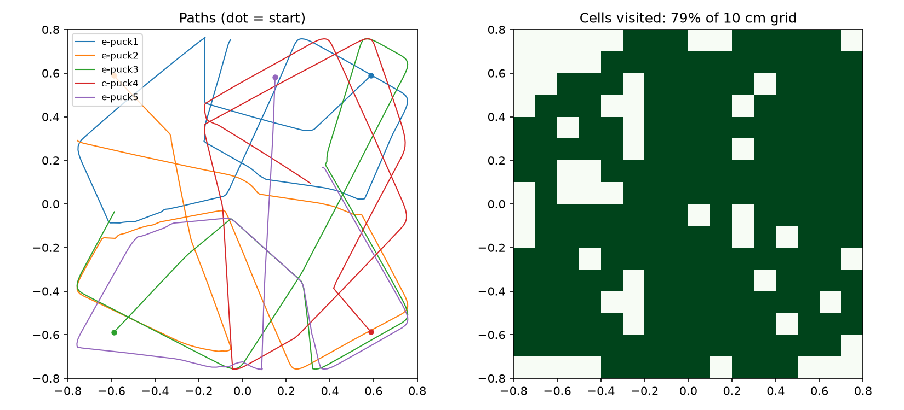

# Webots robotics simulations

Two robot experiments for [Webots R2025a](https://cyberbotics.com), with Python controllers, a headless experiment runner and metrics. They run on macOS, Windows and Linux.

**New here? Start with the [step-by-step guide](GUIDE.md).** It covers installation on every OS, running the experiments, how the algorithms work, which parameters to change, and exercises.

| World | Robot | What it does |
|---|---|---|
| `worlds/swarm_arena.wbt` | 5 × e-puck + supervisor | Braitenberg obstacle avoidance among boxes and barrels. The supervisor logs 120 s of poses to `analysis/trajectories.csv`, then pauses |
| `worlds/pioneer_lidar.wbt` | Pioneer 3-DX + SICK LMS 291 | Follow-the-gap lidar navigation through an 8 × 8 m cluttered room. Logs 180 s to `analysis/pioneer_trajectory.csv` |

## Quick start

1. Install Webots R2025a and Python 3 ([guide, section 2–3](GUIDE.md#2-install-webots)).
2. In Webots: **File → Open World** → `worlds/swarm_arena.wbt`. It starts on its own.
3. Or run it headless and get metrics:
   ```bash
   python3 tools/run_experiment.py swarm --seconds 120 --set cruise=0.9
   ```

Every controller parameter can be changed through the robot's `controllerArgs` field in Webots, or with `--set` on the command line. See [section 8 of the guide](GUIDE.md#8-parameters-you-can-change-and-what-we-measured).

## What we found

- **Swarm:** with default settings five e-pucks cover 75–86% of the arena in 120 s with almost no time stuck. Raising the cruise speed to 0.9 lets them explore more (89%), but one robot drove into a corner too fast to turn and spent 76% of the run wedged.
- **Pioneer:** it never touches an obstacle, but it drives **the same closed loop** for the whole run and covers only 23% of the room, because a reactive controller has no memory. Shrinking the safety bubble below the robot's half-width (0.15 m) leaves it stuck against a barrel.



## Layout

```
worlds/        simulated environments (.wbt)
controllers/   epuck_braitenberg, pioneer_lidar_nav, trajectory_logger (Python)
tools/         run_experiment.py: headless runs with parameters, cross-platform
analysis/      metrics.py, plot_trajectories.py, and saved runs in runs/
```
